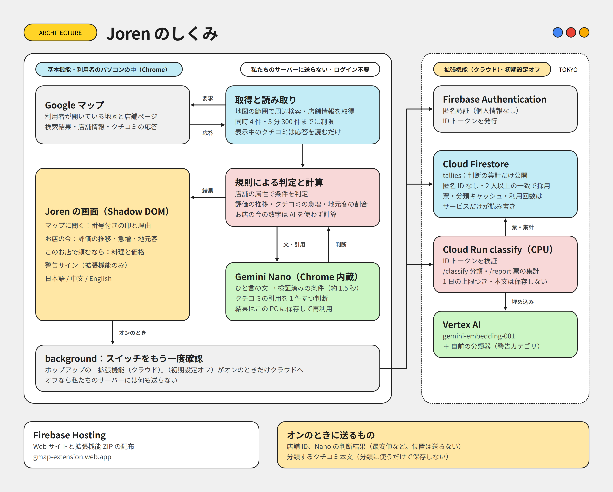

# Joren（常連）for Google Maps

**一見さんでも、常連の店へ。** Google マップの上で動く Chrome 拡張機能です。
DevFest GDGoC Japan Hackathon 2026（カテゴリ：観光）、チーム Day of KAI国人。

- Web サイト（インストール手順と ZIP）：https://gmap-extension.web.app
- 拡張機能 ZIP：https://gmap-extension.web.app/download/joren.zip

旅行者が「1000円以下の和食ランチ」のようにひと言入力すると、パソコンの中で動く Gemini Nano がその文を検証済みの条件に置き換えます。Google マップの店舗情報とクチコミから周辺のお店を 1 件ずつ判断し、当てはまるお店を根拠つきで地図に示します。お店を開くと、クチコミの言語の割合（地元客の目安）、評価の推移、クチコミの急増、よく頼まれる料理がわかります。

## 機能と、動く場所

| 機能 | 内容 | 区分 |
|---|---|---|
| マップに聞く | ひと言 → 条件テンプレート（Gemini Nano）→ 周辺のお店を判断し、地図に番号つきの印 | 基本機能 |
| お店の今 | 直近と以前の評価、サブ評価と客単価の推移、クチコミの急増、オーナー返信、クチコミの言語の割合 | 基本機能（規則で計算） |
| このお店で頼むなら | クチコミでよく話題になる料理を、マップ上のメニューと価格に照らし合わせる | 基本機能 |
| 警告サイン | 値上げ・追加料金・品質低下・衛生・接客などの不満を分類 | 拡張機能（Vertex AI） |
| 共有キャッシュ | ほかの利用者が判断したお店を、Nano を待たずに表示 | 拡張機能（Firestore） |

- **基本機能**：利用者のパソコンの中だけで動きます。ログイン不要で、当チームのクラウドには何も送りません。専用 GPU のないノート PC でも動きます。
- **拡張機能（クラウド）**：ポップアップのスイッチをオンにしたときだけ使います。初期設定はオフです。

UI は日本語・繁體中文・English です（ポップアップで切り替え）。

## アーキテクチャ



```
apps/extension      Chrome 拡張機能（WXT, MV3, React）
  entrypoints/      maps.content（マップ上の UI, Shadow DOM）, maps-tap.content（MAIN world の読み取り）, background, popup
  lib/              判断ロジック（questions, nanoIntent, lunch, health, mapsData, mapsGate, …）
  tests/            node:test。実データの payload から作ったテスト
  fixtures/         調査記録とテスト用データ（Google マップの文章は含めない。下記）
  scripts/          開発用ハーネス、モデル比較・分類器の学習
apps/web            Web サイト（Vite + React, Firebase Hosting）
packages/ui         Web と拡張機能で共通のデザインシステム（DESIGN.md）
services/classify   Cloud Run のサービス：クチコミ警告の分類と、共有判定の集計（README.md）
firestore.rules     クライアントが読めるのは tallies だけ
```

## 動かし方

```
npm install
npm run build:ext      # apps/extension/.output/chrome-mv3 を chrome://extensions で読み込む
npm run dev:ext        # 開発用
npm run test:ext       # 拡張機能のテスト
npm run compile -w apps/extension
python -m unittest discover -s services/classify   # サービスのテスト（ネットワーク不要）
npm run build:site     # 拡張機能 ZIP + Web サイト
npm run deploy         # Firebase Hosting + Firestore ルール
```

Gemini Nano の動作条件：デスクトップ版 Chrome 138 以降。VRAM 4 GB 超、または RAM 16 GB 以上と CPU 4 コア以上、空き容量 22 GB。Nano がなくても、店舗情報だけで判定できる条件と「お店の今」は動きます。

## セキュリティとプライバシー

### パソコンの外に出るもの

| いつ | どこへ | 何を |
|---|---|---|
| いつも | Google マップ（利用者自身のセッション） | マップの画面が使うのと同じ検索・店舗情報のリクエスト（下記「Google マップのデータの扱い」） |
| 拡張機能オンのときだけ | Cloud Run `classify` | 分類するクチコミの本文。保存はせず、カテゴリの確率だけを保存する |
| 拡張機能オンのときだけ | Cloud Run `classify` → Firestore | Gemini Nano の判断（ランチの有無、最安値、根拠の種類）、店舗 ID、匿名 ID。位置・料理名・クチコミの文章は送らない |

匿名 ID は Firebase Authentication の匿名認証です。メールアドレスなどの個人情報はありません。

### 脅威と対策

| 脅威 | 対策 | 残るリスク |
|---|---|---|
| 実在するクチコミに、偽の警告を付けられる | 分類結果のキャッシュのキーを、クチコミ ID と本文の SHA-256 にしている。作り話の本文は別のエントリになり、正しい本文の結果は変わらない（`services/classify/test_main.py`） | なし |
| API を大量に呼ばれ、費用がかさむ | ID トークンを確認する。新しく埋め込む件数に、利用者ごとと全体の日次上限を設ける。1 回のリクエストの件数と文字数の上限、最大 3 インスタンス、予算アラート | 匿名アカウントは作りやすい。全体の上限に達すると、その日は全員の警告サインが止まる（費用を優先した判断） |
| 共有判定の水増し | 投票はサーバーが検証し、利用者ごと・お店ごとに 1 票。2 人以上が一致した判断だけを使い、それ以外は手元の Nano で判断する。投票にも日次上限 | 多数の匿名アカウントで一致させれば通る。上限で規模が限られる |
| 共有データから閲覧履歴を推定される | 投票（匿名 ID つき）はサーバーだけが読める。公開するのは匿名 ID を含まない集計（`tallies`）だけ。`firestore.rules` はそれ以外の読み書きをすべて拒否 | サービスの運営者（私たち）は、匿名 ID ごとの投票を見られる |
| 秘密情報の漏えい | リポジトリに鍵はない。Cloud Run はサービスアカウントの権限で動き、鍵ファイルを使わない。Firebase の Web 設定は公開前提の値で、アクセスはルールで制御する | なし |
| クチコミ本文の保存 | 本文はどこにも保存しない。キャッシュに残るのは確率だけ | 分類の通信中は本文がサービスを通る |
| 拡張機能の権限 | `storage` と、自分たちのサービスのホスト 1 つだけ。マップ上の UI は Shadow DOM。Firebase はバックグラウンドだけで動く。拡張機能スイッチは、コンテンツスクリプトとバックグラウンドの両方で確認する | なし |
| Google マップへの負荷 | すべてのリクエストを 1 つのゲート（`lib/mapsGate.ts`）に通す：同時 4 件まで、120 ms 以上の間隔、5 分で 300 件まで。混雑のしるし（429・確認ページ）が出たら 5 分止まる | 下記 |

### Google マップのデータの扱い

- **受け身で読むもの**：お店のクチコミは、マップの画面自身が読み込む応答（`batchexecute`）をそのまま読みます（`entrypoints/maps-tap.content.ts`、`lib/reviewTap.ts`）。追加のリクエストはありません。
- **拡張機能が送るリクエスト**：「マップに聞く」は、周辺のお店を探すために、マップの画面が使うのと同じ検索と店舗情報の URL を、利用者自身のセッションから呼びます。1 回の質問で約 120 件です。このため、上記のゲートで速さを抑えています。
- **保存するもの**：Google マップの文章（クチコミ、メニュー名、投稿）は、当チームのクラウドに保存しません。保存するのは自分たちの判断（例：ランチあり、最安 ¥880）だけです。根拠の文章は、表示するときにマップから読み直します。
- **Places API (New) を使わない理由**：1 店あたりクチコミが 5 件までで、「直近の評価」やクチコミの急増は計算できません。また、「一人での食事」などの属性がありません。Chrome ウェブストアで公開する前に、利用規約に沿った取得方法へ切り替えることが今後の課題です。

### リポジトリに含めていないもの

- 警告分類の学習に使ったクチコミのコーパス（Google マップの原文）。開発者の手元だけに置いています（`.gitignore`）。
- テスト用データのオーナー返信は、正規化した本文のハッシュに置き換えています（`apps/extension/scripts/sanitize-fixtures.ts`）。重複の判定と「高評価への御礼」の判定は、置き換えの前後で同じ結果になります。調査記録の中のクチコミ本文も削除しています。

## 使った Google の技術

Gemini Nano（Chrome 組み込み AI・Prompt API）、Vertex AI `gemini-embedding-001`、Cloud Run、Cloud Firestore、Firebase Authentication（匿名認証）、Firebase Hosting。どれを、なぜ選んだかはプロダクト説明ドキュメントに書きました。

## ライセンス

コードは MIT License です。フォント（Google Sans、Google Sans Code）は SIL Open Font License 1.1 で、`OFL-*.txt` をフォントの隣に置いています。利用したライブラリ・データ・素材の一覧は「著作物利用シート」にあります。
